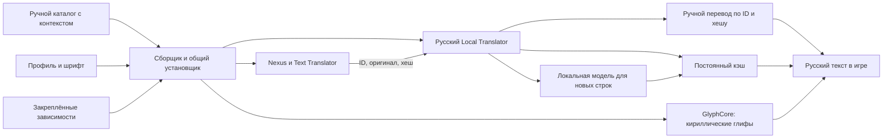

# Как связаны части проекта

Для пользователя это одна установка. Внутри сохранены штатные границы
компонентов: шрифтовые хуки GlyphCore, подстановка текста Text Translator
и отдельный процесс перевода. Наш каталог устанавливается в reviewed-слой
модуля и имеет приоритет перед машинным переводом. Хеш английского оригинала
защищает от применения ручной строки к изменившемуся тексту игры.

Общий установщик проверяет пакет, ставит компоненты и профиль, затем запускает
служебный режим того же EXE для применения каталога. Этот режим использует
общий проверяющий код `tools/catalog.py`. При первом запуске игры модуль
передаёт готовые ручные строки штатным протоколом Text Translator.

Редактор меняет JSON и присылает PR. Проверка выявляет повторы ID, изменённый
оригинал, потерянные подстановки и теги. В сборку попадают только `reviewed`.
Для изменения перевода не требуется пересобирать модель или GlyphCore.

Весь сохранённый машинный кэш и корпус включены в `data/imported/` и
`drafts/ru/` для совместной редактуры. Сборка создаёт из них начальный кэш
по английским текстам и известным ID. Установщик подключает его до ручного
каталога; reviewed-ID в машинную начальную базу не включаются.
Дальнейший личный перенос выполняется командами Export/Import; существующие
записи имеют приоритет при импорте. Общий профиль хранит стартовые значения, а установщик
сохраняет существующие настройки обновления текста и изменённый машинный словарь.
